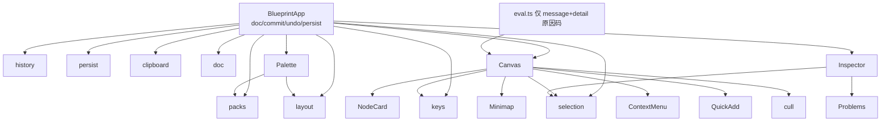

# mem-link 商用化打磨 · 增量架构设计

| 项 | 内容 |
| --- | --- |
| 版本 / 作者 | v1.0（对应 PRD v1.0） / 架构师 高见远 · 范围仅 `src/bp/*` + `styles.css` 蓝图段 |
| 硬约束 | 纯前端零网络；`memlink-blueprint/1` 不破；73 用例全绿；不引 UI/状态/图库 |

## 1. 总体方案
把 `BlueprintApp` 从「4 个独立 `useState` + 各处散落 `setX`」改成**单一文档对象 + 单一写入口**：`doc{packs,nodes,edges}` 由 `docRef`（同步可读）+ `doc` state 双持，**所有变更只能走 `commit(meta, patch, opts)`**。`commit` 内统一做四件事：取 `before` 快照 → 算 `after` → 压历史 → 调度 800ms 持久化。撤销、持久化、脏标记、id 生成器（`seq` 独立于历史、永不回退）只实现一次，PRD 三个架构风险收口到一个函数而非散布到 20 个功能点。

其上叠三层，互不改写内部：**纯计算层**（7 个无 React 依赖模块，全纯函数——项目无 jsdom，这是 M3/M4 可被 vitest 断言的前提）；**画布表现层**（`Canvas` 拆出 `NodeCard`，裁剪/LOD/拖动期 DOM 直写都在这层且**不触碰 `doc`**，P0-14 由构造保证而非标志位）；**交互入口层**（`keys.ts` 单一注册表 + `buildMenu()` 纯函数，菜单项与快捷键共用同一份 `CommandSpec`）。


## 2. 新增 / 修改文件清单
| 路径 | 职责 | 行数 | 类型 |
| --- | --- | --- | --- |
| `selection.ts` / `clipboard.ts` | 选择集合模型与集合运算 / 复制剪切粘贴 + id 重映射（纯） | ~130 / ~100 | 新增 |
| `history.ts` / `cull.ts` | 历史栈 reducer（入栈/合并/撤销/重做/保存点）/ 可见集合+LOD+端口窗口（纯） | ~180 / ~120 | 新增 |
| `persist.ts` | storage 封装、版本、容量预算、降级（纯 + 薄 IO） | ~210 | 新增 |
| `packs.ts` | `PackMeta` 生命周期、禁用/删除原子化、孤儿问题（纯） | ~190 | 新增 |
| `keys.ts` / `layout.ts` | 命令注册表与组合键归一 / 三栏宽度折叠状态机（纯） | ~170 / ~80 | 新增 |
| `NodeCard.tsx` | 单节点渲染，`React.memo` 边界（从 Canvas 拆出） | ~250 | 新增 |
| `ContextMenu.tsx` / `QuickAdd.tsx` | 菜单渲染+键盘导航+边缘翻转 / `Ctrl+K` 搜索浮层 | ~180 / ~140 | 新增 |
| `Minimap.tsx` / `Problems.tsx` / `Splitter.tsx` | 包围盒缩略+视口矩形 / 问题列表+定位 / 5px 视觉 9px 命中分隔条 | ~120 / ~150 / ~90 | 新增 |
| `BlueprintApp.tsx` | `doc` 单一状态、`commit`、undo/redo、持久化调度、保存状态 | 452→~780 | 改 |
| `Canvas.tsx` | 裁剪/LOD/拖动直写/框选/右键/失败气泡，迁出 NodeCard | 677→~520 | 改 |
| `Inspector.tsx` / `Palette.tsx` | 集合展示+批量摘要+问题面板迁出 / pack 管理面版+分组折叠+文案 | 492→~560 / 121→~340 | 改 |
| `doc.ts` / `eval.ts` | 增 `DocBody`/`snapshotOf`/`sameDoc`/旧格式兼容读 / **仅** message 三段式+`detail` 原因码 | 71→~120 / 843→~850 | 改 |
| `styles.css` | 可变栅格、折叠条、LOD、菜单、状态栏、裁剪后 SVG | +~430 | 改 |
| `samples/perf.big.blueprint.json` | 200 节点 / ~2000 端口 / 5MB buffer 基准 | 生成物 | 新增 |
| `tests/*.test.ts` | 9 新增 + `bp.test.ts` 追加（见 §9） | ~1000 | 新增/改 |

> 新建 14 文件理由：交互逻辑若留在组件内只能人工验收（M3/M4 要求可断言）。把选择运算/历史栈/可见集合/菜单模型/键位归一/schema 迁移抽成纯模块，是把 P0-16/19/13/07/05 从「人工走查」转为「vitest 断言」的最小代价。其余在现有文件改造。

## 3. 核心数据结构与接口
### 3.1 文档与快照（`doc.ts`）
```ts
export interface PackMeta { id: string; name: string; source: string; pack: BlueprintPack | null; enabled: boolean;
  origin: 'builtin' | 'imported' | 'created'; updatedAt: number; error?: string }
export interface DocBody { packs: PackMeta[]; nodes: BPNode[]; edges: BPEdge[] }
export type DocSnapshot = Readonly<DocBody>;      // 结构共享的浅数组副本，禁止深拷贝
export function snapshotOf(doc: DocBody): DocSnapshot;              // 仅 [...arr]
export function sameDoc(a: DocSnapshot, b: DocSnapshot): boolean;   // 三数组引用相等
export function maxIdSeq(doc: DocBody): number;                    // 启动/打开图时校准 seq
```
**硬规则**：快照只复制数组，元素按引用复用。`BPNode.source.data` 是字符串，100 层历史共享同一引用 → buffer 内存增量只有指针（满足「只存 base64 引用」）。`history.ts` 里出现 `JSON.parse(JSON.stringify())`/`structuredClone` 一律 review 拒绝。

### 3.2 选择模型（`selection.ts`）
```ts
export type SelectableKind = 'node' | 'edge';
export interface Selectable { kind: SelectableKind; id: string }
export interface SelectionState { items: readonly Selectable[];  // 有序，最后加入者为 primary
  primary: Selectable | null;                                    // 必在 items 内
  entry: { nodeId: string; index: number } | null }               // 元素行焦点，不参与批量操作
export const EMPTY_SELECTION: SelectionState;
export function selectOne(kind: SelectableKind, id: string): SelectionState;
export function addItem(s: SelectionState, kind: SelectableKind, id: string): SelectionState;    // 去重
export function toggleItem(s: SelectionState, kind: SelectableKind, id: string): SelectionState; // Ctrl+点击
export function removeItem(s: SelectionState, kind: SelectableKind, id: string): SelectionState;
export function clearSelection(): SelectionState;
export function selectAll(nodes: BPNode[], edges: BPEdge[]): SelectionState;   // Ctrl+A
export function selectNodes(ids: readonly string[]): SelectionState;           // 粘贴后
export function setEntry(s: SelectionState, nodeId: string | null, index?: number): SelectionState;
export function isSelected(s: SelectionState, kind: SelectableKind, id: string): boolean;
export function selectedNodeIds(s: SelectionState): string[];
export function selectedEdgeIds(s: SelectionState): string[];
export function retainExisting(s: SelectionState, doc: DocBody): SelectionState;  // 删除/撤销后收敛
export function primaryAsLegacy(s: SelectionState): BPSelection;                 // 唯一压回单值出口
export function summaryOf(s: SelectionState): { nodes: number; edges: number; text: string };
```
**迁移**：`Canvas.tsx` 保留导出 `BPSelection`（避免无谓改动），三处 `selection` prop 类型全改 `SelectionState`；`primaryAsLegacy` 只用于「检查器单对象详情」「元素行高亮」。**不变量（单测）**：① `primary===null` ⇔ `items` 空；② `primary ∈ items`；③ 无重复；④ 选择不入历史、不写持久化。

### 3.3 历史栈（`history.ts`）
```ts
export interface DocSnapshotPair { before: DocSnapshot; after: DocSnapshot }
export interface HistoryEntry extends DocSnapshotPair { id: number; cmd: string; label: string; at: number }
export interface HistoryState { entries: readonly HistoryEntry[]; index: number;   // 0..len，当前位置
  saveIndex: number | null; nextId: number; lastMerge: { key: string; at: number; entryId: number } | null }
export interface PushOptions { cmd: string; label: string; mergeKey?: string; mergeWindowMs?: number }
export const HISTORY_LIMIT = 100;
export function initHistory(initial: DocSnapshot): HistoryState;
export function resetHistory(initial: DocSnapshot): HistoryState;   // 打开图/示例/清空画布
export function pushEntry(s: HistoryState, o: PushOptions, p: DocSnapshotPair, now: number): HistoryState;
export function canUndo(s: HistoryState): boolean;    // index > 0
export function canRedo(s: HistoryState): boolean;    // index < entries.length
export function undoLabel(s: HistoryState): string | null;   // entries[index-1]?.label
export function redoLabel(s: HistoryState): string | null;   // entries[index]?.label
export function undo(s: HistoryState): { state: HistoryState; snapshot: DocSnapshot };
export function redo(s: HistoryState): { state: HistoryState; snapshot: DocSnapshot };
export function markSaved(s: HistoryState): HistoryState;    // saveIndex = index
export function isDirty(s: HistoryState): boolean;           // saveIndex !== index
```
- **位置语义**：位置 `p` 的文档 = `p===0 ? entries[0]?.before : entries[p-1].after`；`undo`→`p-1` 取 `before`，`redo`→`p+1` 取 `after`。
- **合并**：`mergeKey` 相同且 `now-lastMerge.at <= mergeWindowMs` 时覆盖最后一条 `after`、保留其 `before`。拖动 `'move'`+窗口 0（吸收 pointerup 抖动）；输入框 `'param:'+nodeId+':'+key`+500ms。
- **超深**：`>100` 从队首丢 `k` 条，`index-=k`，`saveIndex = saveIndex-k>=0 ? saveIndex-k : null`；`null` 时 `isDirty()` 恒 `true`（顶栏停「未保存」，不误报已保存）。
- **清空 redo**：`index < len` 时先截断再压入。**id 生成器**：`seq` 在 `useRef`；重做原样恢复字面 id（序列化深度相等成立），`seq` 永不回退。

### 3.4 视口裁剪与降级（`cull.ts`）
```ts
export interface Rect { x: number; y: number; w: number; h: number }
export interface Viewport { x: number; y: number; k: number; width: number; height: number }
export type Lod = 'full' | 'compact' | 'wire';   // k>=0.5 / 0.25<=k<0.5 / k<0.25
export function lodFor(k: number): Lod;
export function viewportRect(v: Viewport, padRatio?: number): Rect;   // 默认 1.5 屏外扩
export function visibleNodeIds(nodes: BPNode[], sizeOf: (id: string) => { w: number; h: number }, r: Rect): string[];
export function visibleEdgeIds(edges: BPEdge[], visible: ReadonlySet<string>): string[];  // 任一端点可见即留
export function portWindow(a: { count: number; dynTop: number; rowH: number; nodeTop: number;
  viewTop: number; viewBottom: number; overscan?: number }): { start: number; end: number };
export const CULL_THRESHOLD = 80;  export const ELEMENT_PREVIEW = 20;  export const PORT_WINDOW_MIN = 120;
```

### 3.5 持久化（`persist.ts`）
```ts
export const KEY_PACKS='memlink:packs:v1'; export const KEY_GRAPH='memlink:graph:v1';
export const KEY_UI='memlink:ui:v1';       export const SCHEMA_VERSION=1;
export interface PersistEnvelope<T> { version: number; savedAt: number; data: T }
export interface LayoutPrefs { leftWidth: number; rightWidth: number; leftCollapsed: boolean; rightCollapsed: boolean }
export interface UiPrefs { layout: LayoutPrefs; groups: Record<string, boolean>; minimap: boolean }
export interface GraphPayload { nodes: BPNode[]; edges: BPEdge[] }
export interface Limits { maxPackSource: number; maxPacks: number; maxWrite: number; maxBuffer: number }
export const DEFAULT_LIMITS: Limits;    // 1MB / 32 / 4MB / 2MB
export type PersistCode = 'OK' | 'QUOTA' | 'TOO_LARGE' | 'NO_STORAGE' | 'BAD_JSON';
export interface PersistResult { ok: boolean; code: PersistCode; bytes?: number; limit?: number; message?: string }
export interface DroppedBuffer { nodeId: string; name: string; base: number; bytes: number }
export function storageAvailable(): boolean;   // 启动写探针键再删
export function readEnvelope<T>(k: string): { data?: T; code: 'OK'|'MISSING'|'VERSION'|'PARSE' };
export function writeEnvelope<T>(k: string, data: T, l?: Limits): PersistResult;   // 先 stringify 校验
export function removeKey(k: string): void;
export function encodeGraph(doc: DocBody, limitBytes: number): { payload: GraphPayload; dropped: DroppedBuffer[] };
export function decodeGraph(raw: unknown): { doc?: GraphPayload; problems: Problem[] };
export function migrate(raw: unknown): { version: number; data?: unknown };        // v1 恒等
export function schedulePersist(fn: () => void, delayMs: number): { run(): void; flush(): void; cancel(): void };
```
storage 不可用时 `status='degraded'` + 状态栏「未持久化」，不抛异常、不清内存。布局/折叠/分组/小地图统一进 `KEY_UI`（见 D2）。

### 3.6 pack 管理（`packs.ts`）
```ts
export function createPack(source: string, name: string, origin: PackMeta['origin']):
  { meta?: PackMeta; error?: string; issues: Problem[] };
export function renamePack(packs: PackMeta[], id: string, name: string):
  { packs: PackMeta[]; code: 'OK' | 'EMPTY' | 'TOO_LONG' };
export function setEnabled(packs: PackMeta[], id: string, enabled: boolean): PackMeta[];
export interface PackImpact { nodeCount: number; edgeCount: number; nodeIds: string[] }
export function impactOf(doc: DocBody, packId: string): PackImpact;      // 删除二次确认文案用
export function removePackAtomic(doc: DocBody, packId: string, mode: 'cascade'|'orphan'): DocBody;  // 1 条历史
export function enabledPackMap(packs: PackMeta[]): Map<string, BlueprintPack>;   // 仅启用且编译成功
export function packProblems(doc: DocBody): Problem[];
```
`packProblems` 的 `detail` 固定原因码 `PACK_DISABLED`/`PACK_MISSING`/`PACK_COMPILE_ERROR`/`BUFFER_DROPPED`，`nodeKey` 为节点 id → 直接满足 P0-11 定位与 P0-12 稳定原因码，且不改 `eval.ts` 语义。

### 3.7 快捷键（`keys.ts`）
```ts
export type KeyContext = 'global' | 'canvas' | 'inspector' | 'input';
export interface CommandEnv { context: KeyContext; selection: SelectionState; canUndo: boolean; canRedo: boolean;
  clipboardNodes: number; wirePending: boolean; menuOpen: boolean; quickAddOpen: boolean }
export interface CommandSpec { id: string; combos: string[];   // 归一化：'mod+z' | 'mod+shift+z' | 'delete' | 'f2'
  contexts: KeyContext[]; allowInInput?: boolean;              // 仅 esc / mod+s / mod+shift+e 为 true
  label: string; enabled?: (env: CommandEnv) => boolean;       // false → 菜单置灰 + 不 preventDefault
  run: (env: CommandEnv) => void }
export function normalize(e: Pick<KeyboardEvent,'key'|'ctrlKey'|'metaKey'|'shiftKey'|'altKey'>): string;
export function isEditableTarget(t: EventTarget | null): boolean;
export function contextOf(t: EventTarget | null, inCanvas: boolean): KeyContext;
export function createRegistry(specs: CommandSpec[]): { handle(e: KeyboardEvent, env: CommandEnv): boolean;
  lookup(combo: string, ctx: KeyContext): CommandSpec | undefined;
  items(ctx: KeyContext): CommandSpec[]; devCheck(): string[] };
export const RESERVED_COMBOS: readonly string[];   // 'mod+w','mod+t','mod+n','mod+q','mod+shift+t'
```
优先级 `input > inspector > canvas > global`；输入框聚焦时除 `esc`/`mod+s`/`mod+shift+e` 外 `return false` 且不 `preventDefault`；同 combo 同 context 双注册由 `devCheck()` 在 DEV 下 `console.error`。

### 3.8 右键菜单（`ContextMenu.tsx`）
```ts
export type ContextTarget = { kind: 'canvas'; world: { x: number; y: number } }
  | { kind: 'node'; id: string; selectionSize: number } | { kind: 'edge'; id: string }
  | { kind: 'port-in'; nodeId: string; port: string; wired: boolean }
  | { kind: 'port-out'; nodeId: string; port: string; downstream: number };
export interface MenuItem { id: string; label: string; hint?: string; danger?: boolean; checked?: boolean;
  disabled: boolean; reason?: string; run: () => void }        // disabled 必填，禁止省略
export type MenuSlot = MenuItem | { separator: true };
export interface MenuModel { target: ContextTarget; x: number; y: number; slots: MenuSlot[] }
export function buildMenu(target: ContextTarget, env: MenuEnv): MenuModel;    // 纯函数，P0-07 全覆盖单测
export function placeMenu(x: number, y: number, w: number, h: number, viewW: number, viewH: number,
  margin?: number): { left: number; top: number; flippedX: boolean; flippedY: boolean };
```

### 3.9 剪贴板与布局
```ts
export interface ClipPayload { nodes: BPNode[]; edges: BPEdge[]; sourcePackIds: string[] }
export function copyOf(doc: DocBody, sel: SelectionState): ClipPayload | null;
export function remapForPaste(clip: ClipPayload, nextId: () => string, offset: number):
  { nodes: BPNode[]; edges: BPEdge[] };    // 只留两端都在剪贴板内的连线；params 浅拷贝
export function nextOffset(i: number): number;    // 24, 48, 72 …
export interface LayoutState { leftWidth: number; rightWidth: number; leftCollapsed: boolean; rightCollapsed: boolean }
export const LAYOUT_LIMITS: { left: [number, number]; right: [number, number] };  // [240,480] / [320,640]
export const LAYOUT_DEFAULT: LayoutState;    // 330 / 404 / false / false
export function clampWidth(side: 'left'|'right', px: number): number;
export function resetSide(side: 'left'|'right'): number;                        // 双击分隔条
export function autoCollapse(viewportWidth: number): Partial<LayoutState>;      // <1180 / <900
export function stepWidth(side: 'left'|'right', px: number, delta: number): number;
```

## 4. 数据流与时序
### 4.1 一次节点拖动（P0-13/14/16 的唯一交汇点）
```mermaid
sequenceDiagram
  participant NC as NodeCard
  participant CV as Canvas
  participant APP as BlueprintApp
  participant H as history
  NC->>CV: pointerdown(.bp-node-head) → onNodePointerDown(id, shift, mod)
  CV->>CV: selection = shift?addItem : (isSelected?keep:selectOne)
  CV->>CV: dragSession={ids,k,startX/Y,startPos:Map,moved:false}  %% 不求值不改 doc
  loop 每 pointermove（rAF 合并）
    CV->>NC: el.style.transform = translate3d(dx,dy,0)   %% 直写 DOM
    CV->>CV: 相邻 edge path.setAttribute('d', …+delta)
  end
  NC->>CV: pointerup → commitMove(moves)                 %% 一次调用 = 一条历史
  CV->>APP: before=docRef.current; after={…before, nodes: map(命中?{…n,x,y}:n)}
  APP->>H: pushEntry({cmd:'move',label:'移动 N 个节点',mergeKey:'move'},{before,after})
  APP->>APP: docRef=after; setDoc(after); schedulePersist(800ms)   %% 1 次重渲染
  Note over APP: evaluateGraph 渲染期 1 次（拖动期 0 次，useMemo 依赖未变）
  CV->>CV: useLayoutEffect 清除 inline transform 与临时 d
```
**顺序要求**：inline transform 必须在 React 提交后的 `useLayoutEffect` 清，不能 `pointerup` 里先清再 commit（否则一帧回弹）。

### 4.2 其余链路
- **粘贴**：registry 命中 `paste` → 剪贴板空则 `enabled=false`（无动作不报错）→ `remapForPaste(clip, ()=>'n'+(++seq.current), nextOffset(pasteCount++))` → `commit({cmd:'paste'})` → `selection=selectNodes(新 id)`（不入栈）→ 目标 pack 禁用时由 `packProblems` 出 `PACK_DISABLED`，`packId` 不变。
- **删除**：`items` 空则 `enabled=false` → 一次算出 `nodeIds` + 其关联边 + `edgeIds` → `commit({cmd:'delete',label:'删除 N 个节点 / M 条连线'})` → `selection=retainExisting(sel, after)`。现行「删节点」分两次 setState 必须废弃。
- **切换 pack 启用**：`setEnabled` 只改 `packs`（`enabled` 属文档态，入栈）→ `enabledPackMap` 变小 → 该 pack 节点命中 `PACK_DISABLED` → 画布错误态 + 节点库组隐藏；**不删任何节点/边**。
- **删除 pack**：`impactOf` 二次确认 → `removePackAtomic(mode)` 一次产出完整新文档 → `commit`；撤销时源码+节点+连线整体回滚。
- **保存**：`doc`/`ui` 变化 → 800ms 防抖 → `encodeGraph`（超 2MB 丢 buffer）→ `writeEnvelope` → 成功 `markSaved()`；失败按 `code` 提示且 `saveIndex` 不动；`Ctrl+S` 走 `flush()`。

## 5. 性能设计
| 项 | 做法 |
| --- | --- |
| 裁剪边界 | `viewportRect` 用画布宽高 / `k`，四周外扩 1.5 屏；`nodes.length <= 80` 关裁剪（避免小图抖动） |
| 可见判定 | 节点矩形相交（尺寸取 `metas` 的 w/h，不依赖求值）；连线任一端点可见即保留（悬空端交给 problem 解释） |
| 增删同步 | 可见 id 列表 `join('|')` 与上帧比，相同则复用旧数组引用；节点根元素挂 `data-node-id` 供 `querySelectorAll` 断言 |
| 拖动期零渲染 | `React.memo(NodeCard)` + 回调用 `useCallback`/ref 稳定 → 平移缩放只改 `.bp-world` transform 与 `view`，节点 props 不变 |
| 拖动期零求值 | 拖动期完全不动 `nodes/edges` → `result` 的 `useMemo` 依赖未变，`evaluateGraph` 天然不跑；暴露 `window.__bp={evalRuns}` 供 QA 断言增量为 0 |
| SVG 分层 | `.bp-edges` 改 `width=1 height=1 + overflow:visible`（现写死 4000×3000，200 节点裁右下角）；拖动期相邻边 path 用 ref 直写 |
| LOD | `compact` 只渲染标题 + **绝对定位端口点**（保留原 y 与命中盒，不渲染标签行）；`wire` 再降直线 + 去 marker + 去阴影 |
| 元素端口 | `ELEMENT_PREVIEW=20` 折叠预览；展开且 `count>120` 用 `portWindow` 只为视口内行建 DOM，绝对 `top` 撑开总高（不改节点尺寸） |
| 阴影/小地图 | 可见节点 >120 时 `.bp-world[data-dense]` 关 `box-shadow`/`linear-gradient`；小地图节点 >500 按 2px 采样，独立 `<canvas>` 在 `view`/`nodes` 稳定后 rAF 重绘 |

## 6. 兼容与迁移
- **`memlink-blueprint/1` 不变**：`BPDoc` 保持 `{format,packs[{id,name,source}],nodes,edges}`；`packs[]` 新增可选 `enabled?/origin?/updatedAt?`，`parseDoc` 容忍未知字段、旧文件缺省 `enabled=true`。导出仍写全量 buffer（2MB 是 `localStorage` 预算，不是导出格式约束）。
- **持久化版本与失败**：`version !== SCHEMA_VERSION` → 丢弃该键 + 状态栏「缓存版本不匹配，已丢弃」，回落示例图；`migrate()` 为后续版本留插槽。写入先 `JSON.stringify` 校验再 `setItem`，抛错时持久化副本停在上一成功版本、内存文档保留（见 D1）。
- **73 用例保护**：`evaluateGraph` 签名/返回结构、`portsFor`、`canConnect`、`dropPosition`、`makeDoc/parseDoc` 全不变。P0-12 只改 `message`/`detail`，**且必须保留既有断言子串**：`tests/bp.test.ts:120/166/261/381` 断言 `需要缓冲区`、`:153` 断言 `求值失败` 或 `不在缓冲区`、`:436` 断言 `不同的输入文件`——这些词留在 `message` 主体，教程尾巴迁 `detail`。
- **`#v1`/`#v2` 隔离**：新增 CSS 一律挂 `.bp-*` 前缀；新模块只被 `bp/` 引用。

## 7. 任务分解
> **串行/并行**：T1→T2 必须串行（同一 `BlueprintApp` 状态模型）；T2→T3→T4 串行（`Canvas` 指针层是共享写点）；T5 拆两半：**T5a（`keys.ts`+`ContextMenu.tsx`+`QuickAdd.tsx` 纯新增）可与 T3 并行**，T5b（接入 Canvas/Inspector/eval 文案）必须等 T4。

| ID | 标题 | 涉及文件 | 依赖 | 验收标准 | 复杂度 |
| --- | --- | --- | --- | --- | --- |
| **T1** | 三栏工作区与文案清理 | `styles.css`、`Splitter.tsx`、`layout.ts`、`BlueprintApp.tsx`、`Palette.tsx`、`Inspector.tsx`、`Canvas.tsx`（仅删 `.bp-hint`）、`eval.ts`（仅 §8.3） | — | 分隔条 5px/9px、左 240–480 右 320–640 越界停住、双击复位 330/404、`←→`±8 `Home` 复位；折叠留 36px 竖排条且内容不进 DOM，`Ctrl+\`/`Ctrl+Shift+\` 可切；`<1180` 右栏默认折叠+左 300，`<900` 双折叠；状态栏单行含 pack 数/节点边数/ms/保存态/选中摘要；禁用词扫描 0 命中、>40 字常驻说明 0 处 | L |
| **T2** | 文档层：`doc`+`commit`+历史+持久化+pack 管理 | `doc.ts`、`history.ts`、`persist.ts`、`packs.ts`、`BlueprintApp.tsx`、`Palette.tsx`、`Inspector.tsx`、`tests/history|persist|packs.test.ts`、`samples/perf.big.blueprint.json` | T1 | `setDoc/setNodes/setEdges` 仅出现在 `commit` 实现内；撤销/重做按钮可点且置灰正确；连续 20 步撤销后 `JSON.stringify({packs,nodes,edges})` 与操作前深度相等、20 步重做后与操作后相等；一次拖动=1 条、输入框 500ms 合并；刷新后 pack 启用态/图/宽度/折叠一致；`localStorage` 禁用出「未持久化」且无异常；超 1MB pack 被拒并提示实际值与上限；删除 pack 撤销后源码+节点+边同时回来 | L |
| **T3** | 选择集合与批量编辑 | `selection.ts`、`clipboard.ts`、`Canvas.tsx`、`Inspector.tsx`、`BlueprintApp.tsx`、`tests/selection|clipboard.test.ts` | T2 | `Shift`+点击加选、`Ctrl`+点击切换、`Shift`+空白框选、`Ctrl+A` 全选；多选统一描边、批量拖动保持相对位置且只产生 1 条历史；检查器显示「已选 N 个节点」；粘贴 id 全重映射、只留内部连线、偏移 +24 递增、新节点被选中；剪贴板空时菜单置灰且快捷键无动作不报错；批量删除一次完成且无悬挂 id | L |
| **T4** | 画布性能与视图 | `cull.ts`、`NodeCard.tsx`、`Canvas.tsx`、`Minimap.tsx`、`styles.css`、`BlueprintApp.tsx`、`tests/cull.test.ts` | T3 | `perf.big.blueprint.json` 下平移缩放 ≥45fps、p95 ≤33ms；拖动 ≥50fps 且 `window.__bp.evalRuns` 在 down→up 间增量为 0、up 后 +1；`querySelectorAll('[data-node-id]').length <= 可见集合`，平移缩放后无残留；`k<0.5` 仅标题+端口点、`k<0.25` 直线无箭头、恢复后选择不丢；小地图含包围盒+视口矩形、点击/拖动平移、可折叠；`F`/`Ctrl+0`/`Ctrl+1`/`Ctrl+±` 生效 | L |
| **T5** | 交互发现性与就地反馈 | **a**：`keys.ts`、`ContextMenu.tsx`、`QuickAdd.tsx`、`tests/keys|menu.test.ts`；**b**：`Canvas.tsx`、`Inspector.tsx`、`Problems.tsx`、`BlueprintApp.tsx`、`eval.ts`、`tests/bp.test.ts` | T4（a 可提前到 T3 并行） | 单一注册表实现 §4.2 全表，`Ctrl+S`/`Ctrl+O` `preventDefault`；输入框内仅 `Esc`/`Ctrl+S`/`Ctrl+Shift+E` 生效，`Ctrl+A` 在输入框为全选文本；`Ctrl+W/T/N` 不拦截；冲突 DEV 期 console.error；5 类上下文菜单项齐备、禁用项置灰不隐藏且有 `title` 原因、边缘翻转不越界、`↑↓`/`Enter`/`Esc` 可用、右键未选中对象先设为唯一选择（已在多选内则保留多选）；`Ctrl+K`/双击空白搜索浮层，`Enter` 在视口中心添加并选中；连线失败在释放点显示 3s「<端口A> → <端口B>：<原因>」且角标闪一次；顶栏错误计数可点、问题项点击后节点选中+居中+角标高亮 2s | L |

## 8. 批次划分
| 批次 | 内容 | 可演示成果 | 回归重点 |
| --- | --- | --- | --- |
| **B1** | T1 | 可拖宽/可折叠的三栏专业工作区 + 全量文案清理 | 新增 CSS 是否撞到 `#v1`/`#v2`；1180/900 断点；73 用例全绿（T1 只删文案不改逻辑） |
| **B2** | T2 | 刷新后图与 pack 原样恢复 + 撤销/重做按钮 + pack 管理面版 | 旧 `samples/*.blueprint.json` 仍可打开；隐私模式降级不崩；20 步撤销深度相等；`perf.big.blueprint.json` 可加载（为 B3 备数据） |
| **B3** | T3 + T4 | 框选多选→复制→粘贴得独立副本；200 节点 45fps 平移缩放 | 单选/单拖动仍正常（集合退化为 1）；裁剪后连线不丢；低倍率端口仍可点；拖动不产生多余历史条目 |
| **B4** | T5 | 全键位可达 + 右键即菜单 + 就地错误提示 + 问题定位 | 输入框让位（`Ctrl+A`/`Delete`/`Ctrl+Z` 为原生行为）；`Delete` 只删一次（旧双监听已移除）；菜单禁用态与 `enabled` 一致；文案扫描 0 命中 |

每批结束条件：`pnpm build`（含 `tsc --noEmit`）+ `pnpm test` 全绿 + 该批演示脚本可手动走通。

## 9. 测试策略
**纯函数单测**（新增 ~105 例，总量 ~178）：
| 文件 | 覆盖 | 例数 |
| --- | --- | --- |
| `history.test.ts` | 位置语义、20 步 undo/redo 深度相等、redo 清空、超 100 丢最旧并修正 index/saveIndex、mergeKey 窗口合并、markSaved 后 dirty 翻转、saveIndex 失效退化 | ~26 |
| `persist.test.ts` | 2MB 预算丢弃顺序与 `DroppedBuffer`、4MB 超限拒绝、1MB/32 上限、版本不匹配丢弃、`NO_STORAGE`（注入假 storage）、坏数据容错 | ~20 |
| `packs.test.ts` | `removePackAtomic` 两模式、`impactOf` 计数、空名拒绝、`enabledPackMap`、四种原因码 | ~18 |
| `selection.test.ts` / `clipboard.test.ts` | 四条不变量、toggle/add/remove、selectAll、`retainExisting` 修 primary、`summaryOf` / id 重映射无冲突、只留内部连线、`packId` 不变、`params` 不共享引用、offset 递增 | ~16 / ~10 |
| `cull.test.ts` | 1.5 屏外扩、边界相交、单端可见保留、`lodFor` 三档、`portWindow` overscan | ~12 |
| `keys.test.ts` / `menu.test.ts` | ctrl/meta 归一、`isEditableTarget`、上下文优先级、`allowInInput` 白名单、`RESERVED_COMBOS`、`devCheck` 冲突 / 5 类上下文项集合、禁用条件与 `reason`、批量「N 个」、`placeMenu` 四角翻转 | ~10 / ~12 |
| `bp.test.ts`（追加） | 旧文档缺 `enabled` 视为 true、`PORT_MISSING` 原因码存在、既有 6 处文案断言仍命中 | ~6 |

**只能人工验证**（进 QA 走查清单）：帧率/p95、菜单与浮层 ≤100ms 视觉响应、拖动无回弹闪烁、低倍率可读性、边缘翻转观感、离开页面确认、状态栏时间文案。
**不引入 jsdom**：DOM 行为通过「纯函数建模 + `data-*` + `window.__bp` 计数器」转为可断言量，避免为 20 个交互点新建测试基建。

## 10. 风险与缓解
| # | 风险 | 触发条件 | 兜底 |
| --- | --- | --- | --- |
| R1 | 历史栈内存爆 | 有人为「稳妥」在 `commit` 里深拷贝快照 | review 硬规则 + 断言「未变节点引用相等」：`expect(after.nodes[0]).toBe(before.nodes[0])` |
| R2 | 拖动期仍求值 | 有人把拖动续回 `onMove`（`BlueprintApp.tsx:197`）以「让连线跟着动」 | `window.__bp.evalRuns` 断言；`onMove` 删除，只留 `onMoveCommit` |
| R3 | 提交后位置回弹 | 先清 inline transform 再 commit | 统一在 `useLayoutEffect([nodes])` 清；人工慢速拖动盯一次 |
| R4 | 选择模型改不彻底 | 组件残留 `selection.kind === 'node'` | 全库 grep 必须为 0（仅 `primaryAsLegacy` 内例外） |
| R5 | 撤销 pack 删除不原子 | 沿用现 `onRemovePack`（`BlueprintApp.tsx:305`）的 3 次 setState | 只允许 `removePackAtomic`；单测断言撤销后三者同时回归 |
| R6 | 文案改写打破 73 用例 | P0-12 删掉断言依赖的子串 | §6 列出的 5 处子串必须保留；T1/T5 提交即跑全量测试 |
| R7 | 裁剪致连线消失/端口点不到 | 边判定用「两端都可见」；compact 删掉端口元素 | 边改「任一端可见」；compact 端口改绝对定位点，保留 `data-port` 与命中盒 |
| R8 | 写入失败丢用户输入 / `BlueprintApp` 冲突 | 按「内存态回滚」字面实现 / T2-T4 并行改同一文件 | 见 D1：保留内存只标记未持久化 / 任务串行 + 每任务只加一个区块（commit 区·选择区·视口区），review 按区块 |

## 11. 明确不做
与 PRD §10 一致，架构层额外确认：不引 UI 库、状态管理库（Redux/Zustand）、图库（d3/xyflow）、虚拟列表库——裁剪与端口窗口自研；不引 jsdom/RTL/playwright；不 Worker 化求值（P1-04 再评估）；不改 `eval.ts` 求值语义、`NODE_WIDTH`、`canConnect`、`memlink-blueprint/1` 结构；不做 P1（网格吸附、对齐分布、撤销可视化、分片求值、源码行号、PNG/SVG 导出）与 P2 全部；不改 `App.tsx`/`v1`/`v2`（仅 README 标 legacy）；不做多图标签页、浅色主题、节点编组、在线 pack 编辑器、自动布局、协作分享。

## 附：待主理人拍板
| # | 决策点 | 建议 |
| --- | --- | --- |
| D1 | P0-18「`setItem` 抛错 → 内存态回滚到写入前快照」按字面实现会抹掉用户刚做的编辑 | 改为**保留内存文档**，只把持久化副本停在上一成功版本，状态栏「未持久化 · 仅内存」，`saveIndex` 不动 |
| D2 | P0-18 说布局写 `memlink:graph:v1`，§7 说 `memlink:ui:v1`（PRD 冲突） | 布局/折叠/分组/小地图统一进 `memlink:ui:v1`；`graph:v1` 只放 `{nodes,edges}`，避免 UI 点击触发 800ms 图写入 |
| D3 | 是否允许把 `packs/nodes/edges` 三 state 合并为单一 `doc`（`BlueprintApp` 约 450 行改写） | 允许。这是 `commit` 原子性与「拖动期零求值」的前提；不改则历史栈与 pack 原子删除无法可靠实现 |

## 附：交付实现与评审稿的差异

- 持久化实际为双键：`memlink:graph:v1` = `{version,savedAt,data:{packs,nodes,edges}}`，`memlink:ui:v1` = `{version,savedAt,data:{layout,groups,minimap}}`；没有 `memlink:packs:v1`。`MAX_WRITE_BYTES = 2MB`，超限时裁剪 File 的 base64 数据。
- `history.ts` 语义：`cursor === -1` 为 `base`，`entries[i]` 是第 i 次提交后的整份文档；`mergeKey` 500ms 合并，栈深 100。
- 新增 `src/bp/builtins.ts`：19 个内置节点的注册表，纯函数 `run(values, ctx)`，`portsFor` / 求值器 / 节点库 / 快速添加共用。内置节点通过 `buffer` 上下文口继承文件，`calc` 视图新增 `detail` 多行明细。
- 新增 `samples/nvme-sq.bp.ts` / `.bin` / `.blueprint.json` 与生成脚本 `scripts/gen-nvme.mjs`；`BlueprintApp.initialDoc()` 直接读 JSON，示例按钮与默认图同源。旧版示例仅服务 `#v1` / `#v2`，未改动。
- 拖动期 DOM 直写扩展为「节点 transform + 边 path `d` + 两端 `<circle>` 的 `cx/cy`」，取消拖动时按收集到的原始属性还原。
- `CanvasApi` 用 `viewRef` 读取实时视口；`centerWorld()` 补上画布 `getBoundingClientRect()` 原点偏移。滚轮为 native non-passive 监听 + rAF 合并。
- 真实浏览器回归脚本 `scripts/cdp-verify.mjs`（Chrome CDP，39 项），覆盖端点跟随、零求值、落点精度、快捷键、菜单、跟随地址、导航历史、图内查找、字段工具、v1/v2 隔离与控制台异常。

### 第二轮：软件逆向工作流（新增模块）

- `src/bp/navhistory.ts`：导航历史纯函数栈（`NavSnapshot = {view, selection, label}`，上限 40，`pushNav` 清空 forward，同视口同标签去重）。`SelectionState` 深拷贝隔离，避免快照被后续选择污染。
- `CanvasApi` 新增 `getView()` / `setView(v)`：历史恢复需要读写视口；`setView` 对非法值（NaN / k≤0）拒绝并夹在缩放范围内。
- `Canvas` 输出端口三处（compact / full 静态 / full 动态）都挂 `onDoubleClick` → `onFollowPort`；双击前显式清 `pending`，避免浮层打开时残留半截连线。
- `src/bp/FollowPicker.tsx`：地址解析目标选择浮层，键盘 ↑↓/Enter/Esc 完整可用。
- `src/bp/GraphSearch.tsx`：图内查找浮层；地址命中结果由 `BlueprintApp.searchHits` 生成，遍历 `result.views` 的 struct/element/list/array 实例判断 `inst.addr <= a < addr+size`。
- `BlueprintApp`：`recordNav()` 在所有显式导航动作前压栈；`addressInBuffer()` 用 `result.sources`（eval 对孤立 File 也会写入 source，因此所有缓冲区都可见）。
- `Inspector.FieldTable`：`hover ?? pinned` 决定高亮，点击行切换锁定；工具按钮集中放在字段地址条里而不是表格行内——字段表是 5 列固定 grid，加第 6 列会把布局挤坏。
- `keys.ts` 移除了 `onKey` 里的 `e.altKey` 全局拦截，`Alt+←/→` 才能到达注册表；其余命令不受影响，因为 `matchKey` 本身会比对 `p.alt`。
- 已知行为：CDP 驱动 hover 必须用 `buttons: 0` 且 `button:'none'`，声称按下按键会被浏览器当作拖拽而不派发 `mouseenter`。

### 第三轮：多级指针连续跟随

- 新增内置节点 `ptrwalk` 指针步进（20 个内置）：`base + offset` 处读 4/8 字节指针，输出 `address` / `target` / `valid`。**断链语义**：读取地址越界 → `target=0, valid=false`；读到指针但目标越界 → `target=真实读值, valid=false`。不抛错，让整条链继续求值、把断点显示出来。
- `builtins.ts` 新增 `parseOffsetChain()`：解析 `+0x10, +0x24` / `0x10 0x24` / `16,-8` / 全角分隔符，空串表示单级跟随。
- `FollowPicker` 新增偏移链输入 + 指针宽度下拉 + **实时逐级预览**（`onPreview(offsets,width)` 由 BlueprintApp 用 `Memory.readBig` 实现）；预览报错（`parsed.error` 或 `preview.error`）时 Enter 不提交。
- `BlueprintApp.doFollow(item, offsets, width)`：n 个偏移 → n 个 `ptrwalk`（纵向排布，`target→base` 链式连线）+ 1 个解析节点，**一次 commit**，撤销粒度是整条链。预览失败时拒绝并 toast 原因。
- 测试教训：用 `>>>` 填 8 字节测试数据会因移位量取 mod 32 在 i≥4 时循环重复，写出错误的期望值——必须用 `BigInt >> 8n*i`。`ptrwalk` 的语义是 `target` 为真实读值、`valid` 标记目标越界，断言时不要混淆。

### 第四轮：标注节点

- 走**内置节点路线**而不是新的注释层：`note` 在注册表里 `inputs: []`、`outputs: []`，因此自动获得持久化、撤销、复制粘贴、F2、Ctrl+F、多选删除等全部既有能力，无需改 `BPDoc` 结构。
- `portsFor` 对内置节点直接返回注册表的 `inputs/outputs`，所以 `inputs: []` 天然意味着"无数据源上下文口"——零改动。
- 但求值器的 `trace` 对**孤立节点**有"回落到图里第一个文件"的规则（让孤立解析节点能工作）。为让 note/number/string 这类无端口节点永远不归属文件，在 `!root && !carriesContext` 之后追加一条：`!isFile && inputs.length===0 → mode:'none'`。这对 root 也生效。
- **`run` 的入参只包含连线输入**，不含 params——`outputs: []` 的节点要从 `ctx.params` 读配置，`detail` 同理。
- 画布：`data-node-kind` / `data-note-tone` 驱动 4 种标记色；note 用固定高度 textarea（`metaFor` 对 note 特判 `h = HEADER + NOTE_TEXT_H + 10`，否则便签高度会按端口行数算成只剩标题）。
- `metaFor` 高度、`keys.ts` 的 `mod+f` 放行、CDP 的真实按下聚焦（`button:'none'` 不产生 focus）是三处非显而易见的联动点。

### 第五轮：hex 双向定位 + 自动布局

- `autolayout.ts` 纯函数：`adjacency()` 从连线推导上下游（忽略自环与悬空边），`autoLayout()` 分层布局。**孤立节点不参与重排**——它们通常是手工摆放的标注与备用常量，突然飞走反而找不到。Kahn 分层时显式排除孤立节点（否则入度 0 会把它们捞进第一列）。
- 层内排序用**中位数**而非平均值（barycenter 的稳健变体），长边干扰更小。
- **`avoid` 选项**：孤立节点保持原位，但主图可能与它们重叠——布局后检测与 avoid 矩形相交则整体下移。实测把重叠从 4 处降到 1 处（剩下 1 处是拖放测试预先造成的孤立节点重叠，非布局引入）。
- 蓝图节点的真实绘制高度在 Canvas 的 `metas` 里，BlueprintApp 拿不到：新增 `CanvasApi.sizes()`，内部走 `metasRef`。
- HexView 无内部滚动容器（`maxRows` 截断），所以**定位由调用方控制 `addr`**，HexView 只负责 `focusAddr` 的强调（`.hb.sel` + 行高亮）。
- 检查器 `FileEditor` 跳转框支持相对基址的 `+0x100` / `-0x40`，Enter 提交；点选字节 → 地址条 + 「在此解析 →」复用跟随地址浮层。
- CDP 验收口径：自动布局只对它重排的主图负责，保持原位的孤立节点若本来就叠在一起不算布局引入——断言「布局后重叠数 ≤ 布局前」。

### 第六轮：易用性收敛（节点合并）

- **合并原则**：同一件事只保留一个节点，宁可让参数下拉承担变化，也不并列两个节点。
  - `float` → `readint`（label「数值读取」）：`NUM_SIZE_OPTION` 与 `SIZE_OPTION` 分开定义——`arrayread` 的宽度下拉不应出现浮点选项；
  - `bitwise` → `expr`：求值器的操作符表（`& | ^ << >> ~`）本就与 bitwise 的 op 集合一致，bitwise 只是它的下拉封装；
  - `pointer` → `ptrwalk`：ptrwalk 是超集；合并时给 ptrwalk **补上 `hex` 位模式输出**，不丢 pointer 用户已有的能力。
- **迁移**：`types.ts` 导出 `migrateNode()`，`parseDoc`（打开图）与 `deserialize`（旧缓存）两处入口统一调用。bitwise 的迁移按 op 生成表达式模板（`a << b`），a/b 参数值原样带入。
- **死代码**：`legacy?: boolean` 三个使用点（file/number/element）与字段本身整体删除——Palette 从不过滤它。
- **测试口径修正**：`file` / `number` / `element` 走求值器专门分支，没有 `run`；注册表断言要排除这三个，而不是靠 legacy 标记跳过。
- **CDP flaky 修复**：`mouseMoved` 若目标与上次位置相同则不派发 `mouseenter`——hover 类断言必须先移开再移入两步。

### 第七轮：配置自动继承

- `inheritOptions()` 放在 `builtins.ts`（依赖 `BUILTIN_MAP`），纯函数可单测；BlueprintApp 三个创建路径（onAdd / doFollow 解析节点 / 多级指针 ptrwalk）统一接入。
- 展开顺序刻意安排：`{ ...defaults, ...inherited, 显式参数 }`——显式参数（如 ptrwalk 的 pointerSize 来自浮层选择）永远最后展开，继承值不能覆盖用户当前明确的选择。
- 只继承 `select` 类 options 且与默认值不同的项：text 类输入（表达式 / 文本）不继承，避免把上一条公式带进新节点。
- CDP 用 React native setter hack 驱动受控 select（`Object.getOwnPropertyDescriptor(HTMLSelectElement.prototype, 'value').set.call(el, v) + dispatchEvent('change')`）验证继承链路。