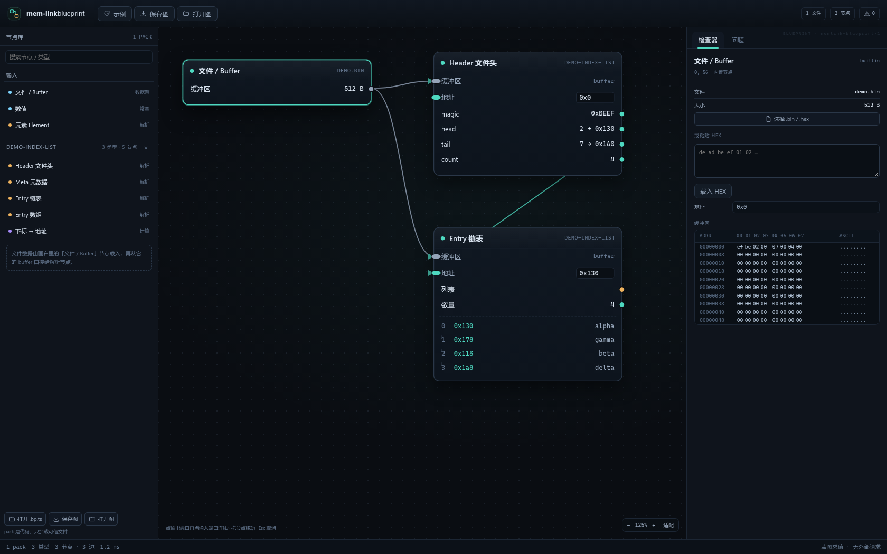

# mem-link

把内存 dump 变成**可执行的解析蓝图**：左侧按 pack 分组，把节点拖到画布连成图，右侧看字段和字节。

一个 `.bp.ts` 文件同时描述结构体布局、链表/数组怎么展开、以及自定义计算节点；画布上的图就是解析器。为内网环境设计：**纯前端、零网络请求、无后端**，构建产物是一个可以双击打开的 HTML 文件。



## 它解决什么问题

- 固件/驱动里的 `next`/`prev` 常常是**池下标**（`addr = base + idx * stride`），hexdump 看不出链表的形状。
- 链表的解析规则因项目而异：有时是下标，有时是地址，有时要按文件偏移换算。规则应该由 pack 定义，而不是写死在工具里。
- 同一个 buffer 可能要在不同地址解析成多条链、多个数组、多个结构体。
- 希望从 `Header.head` 拉一根线到「链表」节点的地址端口，改一个常量就能换一条链。

## 快速开始

```bash
pnpm install
pnpm dev        # http://127.0.0.1:5173
pnpm test       # 单元测试
pnpm build      # dist/index.html（单文件，约 600 KB）
```

`dist/index.html` 内联全部 JS/CSS（含 TypeScript 转译器 Sucrase），**双击即可用**，不需要服务器，也可以直接拷贝进内网机器。

> 若 `$HOME/.npm` 只读，安装时把缓存放进仓库：
> `npm_config_cache=$PWD/.cache/npm pnpm install --store-dir "$PWD/.cache/pnpm-store"`
>
> 部分环境里 pnpm 的 sqlite 状态目录不可写，`pnpm test` / `pnpm build` 会卡在 deps 检查；可直接调二进制：
> `node node_modules/vitest/vitest.mjs run`、
> `node node_modules/typescript/bin/tsc --noEmit && node node_modules/vite/bin/vite.js build`。

示例：

- `samples/nvme-sq.bp.ts` — 默认示例的 pack：NVMe 提交队列（SQE / PRP 表项 / 数据页）
- `samples/nvme-sq.bin` — 4 KiB 示例镜像，基址 `0x1000`
- `samples/nvme-sq.blueprint.json` — 默认图与「示例」按钮共用的蓝图，可直接「打开图」
- `samples/demo.bp.ts` / `demo.bin` / `demo.blueprint.json` — 索引链表的最小示例：结构体 + 链表节点
- `docs/description-format.md` — pack 与节点参考

重新生成 NVMe 示例资产：`node scripts/gen-nvme.mjs`；真实浏览器回归：`node scripts/cdp-verify.mjs`、`node scripts/cdp-verify-follow.mjs`（跟随地址 / 元素解析 / 就地重命名 / 标注缩放）、`node scripts/cdp-verify-core.mjs`（从空画布拖入 `samples/demo.bin` 与 `demo.bp.ts`，走完 bin → 结构体 → 链表 → 跟随字段，22 项）、`node scripts/cdp-verify-tree.mjs`（结构树：三个入口、展开、搜索、下标跳转、树内定位、跟随返回、footer 入口、生成解析节点、退出，24 项）、`node scripts/cdp-verify-tree-truncation.mjs`（5000 项数组从截断 footer 跳到第 4096 项）、`node scripts/cdp-verify-add-defaults.mjs`（非零文件基址下新增链表节点继承地址）。

### 默认示例：NVMe Submission Queue

打开即是一条完整的读命令解析链，12 个节点、13 条连线，求值结果无错误：

```text
nvme-sq.bin ──> 提交队列 SQ (4 × 64 B SQE)
                    └─ elem:0 ─> 元素 · Sqe ─┬─ opc ─────> 枚举 / 标志 → Read
                                             ├─ nlb ─────> 传输长度 / 页数 → 3072 B / 6 页
                                             ├─ prp1 ────> PRP / 分散页 ─> 6 个页地址 + 每页数据预览
                                             │              └─> 数据页 (LBA 0)
                                             ├─ prp2 ────> PRP 列表 (5 项)
                                             │              └─ elem:0 ─> 元素 · PrpEntry
                                             │                            └─ addr ─> 数据页 (LBA 1)
                                             ├─ prp1 ────> 缓冲区切片（hex + ASCII）
                                             └─ prp1 ────> 校验和（CRC32 / 累加和 / FNV-1a）
```

镜像布局：`0x1000` 起 4 条 SQE，`0x1100` 是 PRP 列表页，`0x1200` 起每 `0x200` 一页数据。SQE #0 是 `Read`（OPC `0x02`、CID 1、NLB 5），PRP1 指向首页，PRP2 指向 PRP 列表；列表里的每一项继续指向对应的数据页。

### 内置节点

节点库按「数据源 / 常量 / 解析 / 数值 / 地址 / 校验」分组，共 18 个内置节点：

| 分组 | 节点 |
| --- | --- |
| 数据源 | 文件 / Buffer、缓冲区切片 |
| 常量 | 数值、文本常量、标注 / Note |
| 解析 | 元素解析、数值读取、字符串读取、数组读取 |
| 数值 | 表达式（含位运算）、位域、枚举 / 标志、时间戳 |
| 地址 | 地址计算、指针步进、PRP / 分散页 |
| 校验 | 校验和、数值比较 |

宽度、符号、字节序、编码、表达式等参数在检查器「配置」区修改；十六进制转储、位布局、PRP 页预览在检查器「明细」区展示。内置节点声明集中在 `src/bp/builtins.ts`，节点库、快速添加、求值器共用同一份定义。

**关于节点合并**：同一件事只保留一个节点。`浮点读取` 并入了「数值读取」（宽度下拉含 f32 / f64）；`位运算` 并入了「表达式」（`& | ^ << >> ~` 都是合法操作符）；`指针解引用` 并入了「指针步进」（偏移填 0 即纯解引用）。打开旧图或读取旧缓存时自动完成迁移，无需手工处理。

**配置自动继承**：再次添加同类节点时，宽度 / 符号 / 字节序 / 指针宽度等下拉会沿用上一次的设置——连续解析同一结构时不必逐个重设；显式修改任意一项都会以你改的为准。

## 逆向工作流

这一节描述的是 ImHex / 010 Editor / Ghidra 那类**软件逆向**工具的日常工作方式，mem-link 把它做成了图上的四个动作。

### 跟随地址（Follow pointer）

看到一个指针值，想知道它指向什么：

- **双击端口**：输出端口把自身当前值当作地址；输入端口跟随它上游连线的值（并自动把新节点接回那条线）。弹出「在此地址解析 0x1200」浮层，列出所有可用的解析入口：各 pack 的结构体 / 数组 / 链表，以及注册表里全部按地址工作的内置节点（切片、数值读取、字符串读取、数组读取、指针步进、PRP、校验和）。元素端口（`elem:0`、字段端口）同样可双击，跟随的是该元素自己的地址。
- **元素解析（只在类型可推断时出现）**：来源端口本身是元素、或该地址已经有节点按某个类型解析过时，列表顶部才出现「元素解析」，并写明推断出的类型与原因（如「该地址已按 DataBlock 解析过」）；按下 Enter 直接在该地址解码，字段端口随类型生成。类型推断不出来、或同一地址已经按多种类型解析过时**不提供这一项**——不拿第一个类型硬猜，避免「看似解析成功、字段全错」。类型只由推断写入，浮层里不提供手动指定。
- **右键输出或输入端口**：菜单第一项就是「跟随地址 0x1200…」；端口值不是有效地址时该项会禁用并说明原因。
- **检查器字段行**：字段值落在缓冲区内时，字段工具条出现「在此解析 →」。
- 选定类型后一次提交：**新建节点 + 自动连一条 `address` 线 + 视口居中**，只用一条撤销记录。上次用过的候选会自动高亮，连续跟指针时不用每次重选。
- 在结构树里生成解析节点或跟随字段时，会优先接回对应的图上端口；如果该行没有可用端口（例如截断后的元素），则接回原数据源，地址仍可编辑。

### 多级指针

多级指针是逆向里最绕的操作，mem-link 把它做成**一条偏移链**：

- 跟随地址浮层里填「偏移链」，如 `+0x10, +0x24, -0x8`（也接受空格、分号分隔，支持十进制与负偏移）。
- 每填一步就**实时预览**逐级地址：`0x1000 +0x10 → 0x14a0`、`0x14c4 +0x24 → 0x2000`、`最终 0x2000`；指针宽度可切 4 / 8 字节。
- 某一级读出的地址越界时立即标红并禁止提交，避免展开一条必然失败的链。
- 提交后一次性生成整条链：每级一个「**指针步进**」节点（在 `base+offset` 处读指针），节点间 `target → base` 相接，最后接上解析节点。全部纵向排布、自动居中，一条撤销记录。
- 断链不中断求值：「指针步进」在读取地址越界时输出 `target = 0`、`valid = false`；读到了指针但目标越界时 `target` 是真实读值、`valid = false` —— 能看出断在哪一级，而不是整图报错。
- `offset` 是普通 number 输入，可以从其它节点连线过来（例如由结构体字段算出的偏移）。

### hex 与画布双向定位

- **hex → 画布**：选中文件节点，在「缓冲区」的 hex 里点任意字节，下方出现地址与「在此解析 →」，直接进入跟随地址浮层——看到可疑指针点一下就能展开解析。
- **画布 → hex**：跳转框支持 `0x1200`、十进制，以及相对文件基址的 `+0x100` / `-0x40`，回车后 hex 从该处显示并高亮选中字节。
- 结构体 / 元素节点的字节区同样可点：点一个字节会**反向选中包含它的字段**，与「字段悬停 → 字节高亮」构成双向联动。

### 一键自动布局

顶栏「布局」按钮或 `Ctrl+L`（画布右键菜单里也有）：按**数据流方向**把解析链从左到右分层排开。

- 层级 = 最长路径，`File → Header → 链表 → 元素 → …` 天然成一条从左到右的主线。
- 层内用两轮 barycenter（按邻居中位位置）排序，减少连线交叉。
- 分叉 / 汇聚节点垂直排开，按实际高度累计，互不重叠。
- **孤立节点（标注、备用常量）保持原位**；主图若与它们重叠会整体下移绕开。
- 一次提交，`Ctrl+Z` 一键还原；布局后自动适配全图。

### 标注节点（图上便签）

分析结论、待办、地址含义直接钉在图上，随图保存，不需要另开文档：

- 从左栏「常量」组拖入「标注 / Note」，**在画布上直接打字**；检查器里也能编辑同一份内容。
- 右下角手柄可拖动改宽高（拖动时实时预览，松手一条撤销记录）；双击手柄恢复默认尺寸。尺寸写进节点参数，随图保存，自动布局 / 小地图 / 适配都按实际大小计算。
- 四种标记色：`标注`（青）、`说明`（蓝）、`疑点`（橙）、`重点`（红），在检查器「配置」区切换。
- 标注是纯文档节点：不携带文件上下文、不参与数据源继承，画布上也没有端口行——它不会污染解析链的归属。
- `Ctrl+F` 能检索标注文本，方便在一张大图里找到某条结论。
- 走普通节点的持久化、撤销/重做、复制粘贴与删除路径；多人交接时，把图连同标注一起导出即可。

### 回到原处（导航历史）

沿指针跳几层之后要回看上游：`Alt+←` 返回上一个视口与选中态，`Alt+→` 前进。顶栏 `‹` / `›` 按钮等价，tooltip 显示要回到的位置。入栈点包括：跟随地址、图内查找定位、问题定位、适配全图 / 适配选中、菜单里的「定位来源 / 目标 / 下游」；普通平移和缩放不占用历史。

### 在图里找东西（Ctrl+F）

- 按节点标题、自定义名（F2）、类型、pack、端口名检索；
- 直接输入 `0x1400` 会列出**覆盖该地址的实例**，并显示相对偏移（如 `0x1400 +0 / 512 B`），回车即选中并居中。
- 对应的快捷键是 `Ctrl+F`（`Cmd+F`）。

### 字段 ↔ 字节联动

检查器的字段表：悬停即高亮缓冲区里对应字节，**点击锁定**（再点取消），并显示该字段的绝对地址范围；工具条提供 `值` / `地址` / `HEX` 三种复制，以及字段值可跳转时的「在此解析 →」。

### 快捷键

| 键 | 作用 |
| --- | --- |
| 双击端口 | 输出端口取自身值、输入端口取上游值，打开「在此地址解析」 |
| 双击节点标题 | 就地重命名（Enter 提交 / Esc 取消；F2 也可） |
| `Ctrl+F` / `Cmd+F` | 图内查找：节点、类型、端口，或直接输入地址 |
| `Ctrl+L` / `Cmd+L` | 一键自动布局（按数据流方向从左到右） |
| `Alt+←` / `Alt+→` | 返回 / 前进到上一个视图（跟随地址、查找定位后最有用） |
| `/` | 聚焦左侧节点库搜索 |
| `F2` | 重命名选中节点 |
| `Mod+K` | 快速添加节点 |

## 核心概念
```text
File/Buffer ──buffer──> Header ──head──> Entry 链表 ──elem:0──> 另一个 Header
  │                       │                  │                      │
  └ base / size           └ 字段输出          └ 每个元素一个 out      └ 自动继承同一份文件
    （都可连线）

数据源沿连线依次继承：接一次 File，后面每一级节点都自动沿用它的 buffer。
输入一旦连线，输入框就变成上游传来的真实值；点 × 断开恢复手动输入。
```

- **pack**：一个 `.bp.ts`，导出 `types`（内存布局）和 `nodes`（解析/计算节点）。
- **节点实例**：画布上的一个节点 = pack 里的节点定义 + 地址/参数绑定。
- **拖放添加**：从左栏把节点拖到画布任意位置，就在落点创建；拖动时有跟随鼠标的虚线框预览落点，画布边框高亮表示可放置。单击节点库仍可快速添加（自动找空位）。平移/缩放后落点依然准确，拖出画布或按 `Esc` 取消。
- **新增解析节点的初始地址和数据源**：单选已载入的文件或有明确文件来源的解析节点时，新节点沿用同一份文件，并预填有效的解析地址或文件基址。没有明确上下文时，单文件图可预填文件基址，多文件图仍从 `0x0` 开始；地址和数据源都能在检查器修改。
- **File 是真正的数据源节点**：输出 `buffer`（文件）、`base`（基址）、`size`（字节数），都能往外拉线。把 `buffer` 接到某个节点的「数据源」口，这个节点就属于该文件。
- **数据源依次继承**：每个解析节点都有一个可选的「数据源」输入（虚线圆点）。不接时，它沿任意入边向上逐级继承上游节点的文件——`Header → 链表 → 元素 → 另一个 Header` 全程共用一份 buffer，不必每个节点都接 File。优先级：**数据源直连 > 检查器手动指定 > 沿连线继承 > 图里第一个文件**。
- **继承时不显示数据源圆点**：节点一旦从上游继承，那个虚线圆点就先隐藏，避免在继承之外再叠一条线造成「到底用哪个文件」的混乱；行上仍显示 `继承 · 文件名`（未接线时按来源显示 `指定 / 继承 / 默认 · 文件名`，接线后直接显示文件名 + `×`）。断开上游连线后圆点会重新出现；也可以直接在检查器「数据源」里指定文件（此时原有的数据源连线会一并断开），或从上游重新拉一条线（原来的手动指定会被清掉）。
- **不会静默换文件**：连线或手动指定指向的文件没有载入内容时，节点**不会**再悄悄改读别的文件——它直接报「数据源：连线的来源没有文件内容 / 指定的文件还没有载入内容」，并在问题列表里给出修法（给来源载入 `.bin/.hex`，或断开这条数据源连线 / 把「指定数据源」改回自动）。
- **字符串本身就是数据源**：把「文本常量」的 `文本`、字符串读取的 `十六进制`，或任意 `bytes` 输出接到「数据源」，这段内容会直接当作基址 0 的内存来解析——不必先落成文件。画布上的数据源行会显示 `字符串 N 字符` / `字节 N B`，节点里的地址从 0 开始算。
- **没有内容的来源接不上**：数字输出（如文本常量的 `长度`、数值常量）、标注这类既没有文件也没有文本/字节可传的来源，拖到「数据源」时端口会标成不可接，松手直接提示「不携带文件或字符串，不能作为数据源」，不会产生一条看似生效、实际回退到别的文件的连线。
- **多文件**：多个 File 各自连线，下游按自己的继承链归属；上游来自不同文件时会告警，可手动指定。
- **边**：类型化的值。`number` 接 `number`，`list` 接 `list`；`instance`（元素）可以直接接 `number`，取的是元素地址；「数据源」口接受携带文件的输出，或字符串 / `bytes` 输出。
- **输入回显**：某个输入被连线后，画布与检查器里的输入框自动变成上游的实际值（地址按 `0x…` 显示），并带来源提示和一键断开；断开后恢复原来的手动输入。
- **元素级输出**：链表/数组的每个元素、结构体里 `array`/`record` 字段的每个成员都是一个可连线的输出点。把「链表 #2」接到另一个节点的 `address`，就会在 #2 的地址上重新解析，并沿继承链沿用同一份文件。
- **Element**：接一个 `instance`，或用 `list` + `index` 把列表项展开成字段端口；由「在此地址解析 → 元素解析」创建时还会带 `address`，按推断出的类型在该地址解码。类型只来自推断，不手动指定；没有连接时节点是空的，不显示任何结构体字段。
- **图**：顶栏 `保存图` / `打开图` 导出 `memlink-blueprint/1` JSON；pack 源码、连线和每个 `File` 节点自己的 buffer 都在图里。数据源连线会原样保存。打开图、恢复示例或拖入 `.json` 时，若当前有未保存改动会先确认；新图按**可读比例**打开（放不下时从左上角铺开，而不是压成 38% 的缩略图），随时可点 `适配` 看全貌。
- **问题入口**：顶栏右侧的问题计数就是唯一入口，点击在右栏切到「问题」页签；点某条问题会选中并居中对应节点，同时切回检查器。没有问题时点击只提示「没有发现问题」，不会打断当前检查。

## 写一个 pack

```ts
/// <reference path="../types/memlink-bp.d.ts" />

const BASE = 0x100;
const STRIDE = 24;

const idxToAddr = (v: unknown) => {
  const n = Number(v);
  return n < 0 ? null : BASE + n * STRIDE;
};

const Header = struct('Header', 8, [
  u16('magic', 0, { format: 'hex' }),
  u16('head', 2, { transform: (v) => idxToAddr(v) }),
  u16('tail', 4, { transform: (v) => idxToAddr(v) }),
  u16('count', 6),
]);

const Entry = struct('Entry', 24, [
  i16('next', 0, { transform: (v) => idxToAddr(v) }),
  i16('prev', 2, { transform: (v) => idxToAddr(v) }),
  u16('flags', 4, { format: 'hex' }),
  str('name', 8, 12),
  u32('ts', 20, { format: 'time' }),
]);

export default definePack({
  name: 'demo-index-list',
  endian: 'little',
  pointerSize: 4,
  constants: { BASE, STRIDE },
  types: { Header, Entry },
  nodes: {
    header: structNode(Header, { label: 'Header 文件头' }),
    entries: listNode(Entry, {
      label: 'Entry 链表',
      // 收到的是字段 portMode 对应的值（默认转换后的地址）
      next: (e) => (typeof e.value.next === 'number' ? e.value.next : null),
      max: 256,
    }),
    table: arrayNode(Entry, { label: 'Entry 数组', count: 8, stride: 24 }),
    toAddr: calcNode({
      label: '下标 → 地址',
      inputs: { index: 'number' },
      outputs: { address: 'number' },
      run: ({ index }) => ({ address: BASE + Number(index) * STRIDE }),
    }),
  },
});
```

### 字段构造器

`u8/u16/u32/u64`、`i8/i16/i32/i64`、`f32/f64`、`bool/char/ptr`、`str(name,offset,count)`、`bytes(name,offset,count)`、`bits(name,offset,size,bitOffset,width)`、`record(name,offset,type)`、`array(name,offset,type,count)`。

`struct(name,size,fields)` / `union(name,size,fields)` 定义布局；字段偏移按字节写死，工具不再解析 C。

常用的字段选项：

| 选项 | 作用 |
| --- | --- |
| `format: 'hex' \| 'bin' \| 'time' \| 'timeMs' \| 'char'` | 显示格式 |
| `transform: (v, ctx) => unknown` | 字段显示/端口值转换 |
| `endian: 'little' \| 'big'` | 覆盖 pack 字节序 |

### 节点构造器

`structNode` / `listNode` / `arrayNode` / `calcNode` 的签名、输入输出与各自选项只在一处维护：[`.bp.ts` pack 参考 §4 节点](docs/description-format.md#4-节点)。

`buffer` 输入是**可选的数据源端口**：接上就直连该文件，不接就沿上游依次继承；它不参与节点的值计算，所以保持为空也能正常工作。只有携带文件的输出（File、切片、解析节点等）能接进来；常量类输出会被拒绝并提示。节点已经从上游继承时，这个圆点会暂时隐藏（行上仍显示继承的文件），断开上游连线后重新出现。

内置节点：`File / Buffer`（持有 buffer，输出 `buffer` / `base` / `size`）、`Number`（常量）、`Element`（空节点；接 `instance` 或 `list` + `index` 后生成字段）。

`Element` 的字段端口**跟随实际接进来的元素类型**：接 `Entry` 元素就显示 `next`/`prev`/`name`/`ts`，接带 `array`/`record` 字段的元素还会展开嵌套成员端口。没有元素/列表输入时**不铺任何模板字段**；只有「元素解析」跟随地址时推断出的类型会随 `typeId` 写入，并在 `address` 处解码。类型不通过检查器手动指定——猜错类型会得到看似成功、实际字段全错的结果。

## 使用流程

1. 最快的上手路径：把 `.bin` / `.hex` **直接拖进窗口**（或点顶栏「载入 dump」）——会自动新建 File 节点并载入；也可以点「示例」看 demo，或从左栏「导入 .bp.ts」加载自己的 pack。
2. 从左栏把 `文件 / Buffer` **拖到画布**上想要的位置（单击也可，会自动放到视图中心附近的空位）；选中它，在右侧选择 `.bin`/`.hex`，或直接粘贴十六进制。其它解析节点同样拖动添加，拖动时画布上的虚线框就是落点预览。
3. 从 File 的 `缓冲区` 圆点拉线到第一个解析节点的 `数据源` 圆点。此后同一条链上的节点都会**依次继承**这份文件，不用再逐个接：例如 `Header.head → 链表.address → 链表#0 → 另一个 Header.address`。节点头部显示实际文件与来源方式（直连 / 继承 / 手动 / 默认）。
4. 需要解析 A/B 两个文件时，放两个 File 节点各自载入并分别接到各自的链；下游按继承链归属，互不干扰。上游来自不同文件会告警，可在检查器「数据源」里手动指定。
5. 想把链表里某个元素再按别的类型解析，直接从该元素右侧的圆点拉线到目标节点的 `address`（或接到 `Element` 的 `元素` 输入），文件会自动继承下去。
6. 点端口连线：输出 → 输入，也可以从输入反向拉到输出；拖线时兼容端口会高亮。不兼容的类型会被拒绝，点空白或 `Esc` 取消。
7. 输入一连上，输入框就显示上游真实值；点值旁边的 `×` 断开，恢复手动填写。选中节点看右侧检查器：数据源继承链、字段、原始值/转换值、字节高亮；选中列表条目看单个元素。
8. `Delete` 删除选中的节点或边；节点可拖动，画布可平移/滚轮缩放。
9. `保存图` 导出 JSON；`打开图` 恢复 pack、节点、数据源连线和每个 File 节点自己的 buffer。

## 快捷键

| 键 | 作用 |
| --- | --- |
| `Delete` / `Backspace` | 删除选中节点或边 |
| 滚轮 | 以光标为中心缩放 |
| 拖动空白 | 平移画布 |
| 拖动节点头 | 移动节点 |
| 双击节点标题 | 就地重命名节点（Enter 提交 / Esc 取消） |
| 拖动标注右下角手柄 | 调整标注宽高（双击手柄复位） |
| 从左栏拖节点到画布 | 在落点创建节点（虚线框预览落点；拖出画布或 `Esc` 取消） |
| 单击节点库条目 | 自动找空位快速添加 |
| 点输出 → 输入 / 点输入 → 输出 | 连线（双向都可起线） |
| 点输入值旁的 `×` | 断开该输入，恢复手动输入 |
| `Esc` / 点画布空白 | 取消正在连的线 |

## 安全边界

- pack 是**代码**：工具用 Sucrase 去掉类型，再用 `new Function` 执行；只加载可信文件。
- 页面没有网络请求；CSP 需要允许 `unsafe-eval`（或 `wasm-unsafe-eval` 之外的脚本求值）。
- 图上列表最多 4096 项；全屏结构树按需解码，链表上限取 pack 的 `max`，未声明时为 20 万条硬上限。越界、环、未知类型都会变成图上的问题节点/条目，不会静默截断。

## 代码结构

```text
src/bp/         蓝图 UI：Canvas / Palette / Inspector / BlueprintApp
src/bp/builtins.ts  内置节点注册表（端口 / 配置 / 求值）
src/bp/load.ts  .bp.ts 编译、执行、校验
src/bp/eval.ts  图求值：端口、字段解码、list/array/element/calc
src/bp/types.ts 端口/节点/图的数据模型
src/core/       pack 布局、内存、hex、字段写回
samples/        NVMe 示例与索引链表最小示例
scripts/        示例生成、性能基准、真实浏览器回归
docs/           设计文档与 pack 参考（索引见 docs/README.md）
```

## 已知限制

- 图是纯 DAG；任意 `if/for` 请写进 `calcNode.run` 或 pack 的普通函数。
- 只读解析：字段写回（在十六进制视图直接改值）随旧版路由一并移除。
- 多级指针、union 的 tag 自动判别、跨 pack 类型引用还没做。
